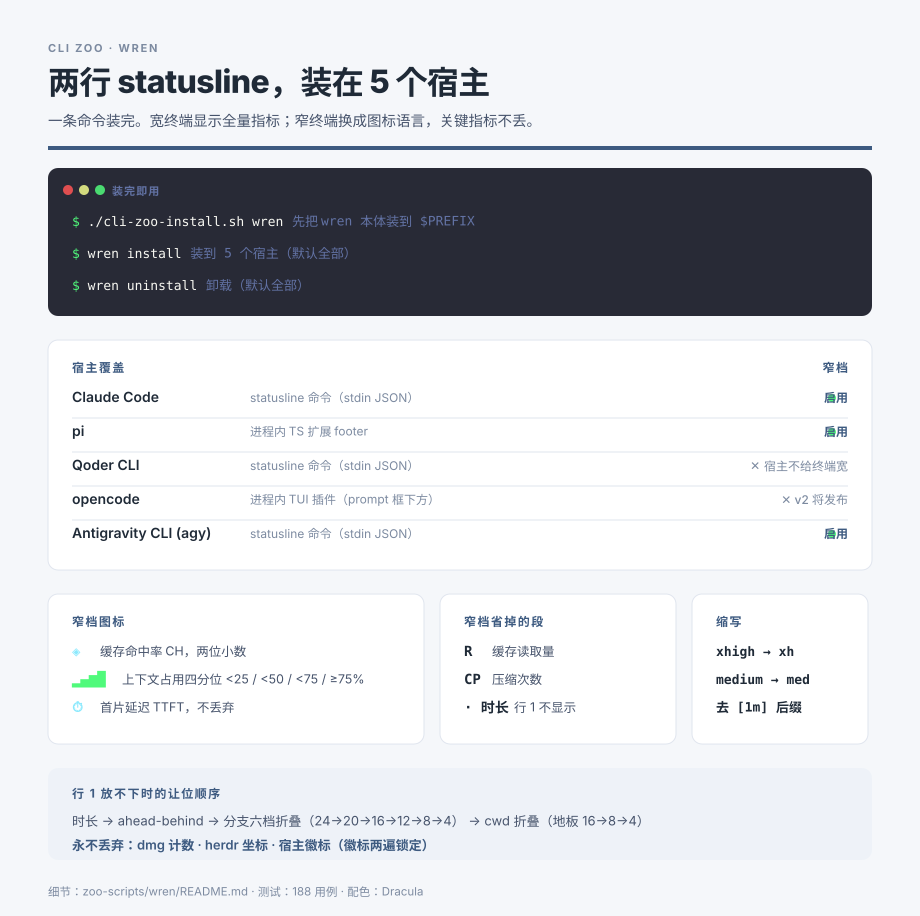
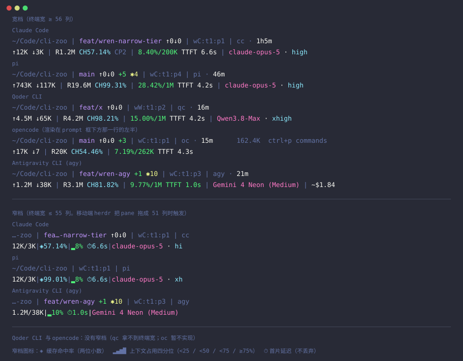

[中文](./README.md) | [English](./README.en.md)

# cli-zoo

[](./LICENSE)
[](https://github.com/Spoon94/cli-zoo)
[](#)
[](#contributing)

> A personal collection of small command-line tools, organized in a separate directory per tool and ready to use out of the box.

Each tool lives under [`zoo-scripts/<animal name>`](./zoo-scripts) (either a single script or a multi-file directory; the entry point is directly executable). Symlink it into `$PREFIX` (`/usr/local/bin` by default) with `cli-zoo-install.sh` in the repository root to use it globally.

## Table of Contents

- [Quick start](#quick-start)
- [Tool list](#tool-list)
  - [otter](#otter)
  - [wren](#wren)
- [Install and uninstall](#install-and-uninstall)
- [Contributing](#contributing)
- [License](#license)

## Quick start

Taking `otter` as an example:

```bash
# 1. Clone this repository
git clone https://github.com/Spoon94/cli-zoo.git
cd cli-zoo

# 2. Install otter into /usr/local/bin (sudo may be required)
./cli-zoo-install.sh otter

# 3. Verify
otter -h
```

If you would rather not touch `/usr/local/bin`, use `PREFIX` to specify any writable directory:

```bash
PREFIX=$HOME/bin ./cli-zoo-install.sh otter
```

## Tool list

### [otter](./zoo-scripts/otter)

Uses tmux to combine an AI CLI tool, a file manager, an editor and a git client into a ready-to-use development session layout, so one command gets you into a working state.

```bash
otter -c <tool> [-s <session>]   # Start or reuse a session
otter -ks <session>              # Kill the specified session
otter -h                         # Help
```

Allowed values for `-c` (the `ALLOWED_TOOLS` allowlist): `claude`, `qodercli`, `opencode`. The layout is the CLI tool on the left, yazi in the upper right and an empty shell in the lower right; when `nvim` / `lazygit` is detected, one window is opened for each; missing soft dependencies degrade automatically.

### [wren](./zoo-scripts/wren)

wren installs a two-line statusline (Dracula color scheme) into 5 hosts: Claude Code (`cc`), pi (`pi`), Qoder CLI (`qc`), opencode (`oc`), Antigravity CLI (`agy`).
The names in parentheses are the target names for `wren install`.
wren copies the files to each host. After installation, the hosts no longer depend on the location of this repository.





When the terminal is 56 columns wide or more, wren renders the wide tier. When it is 55 columns wide or less, cc, pi and agy render the narrow tier.
The narrow tier uses 3 kinds of icons: `◈` cache hit rate, `▂▄▆█` context usage quartile, `⏱` time to first chunk.
The narrow tier covers 3 hosts. qc cannot get the terminal width, and oc does not implement it yet.

```bash
./cli-zoo-install.sh wren            # Step 1: install wren into $PREFIX
wren install [cc|pi|qc|oc|agy|all]   # Install to the hosts. Default: all. Idempotent. Aliases: claude, qoder, opencode, antigravity
wren uninstall [cc|pi|qc|oc|agy|all] # Uninstall. Default: all
wren -h                              # Show help
```

Installing to cc / qc / agy / oc requires python3; installing pi alone does not. `all` does not check whether a host is installed:
if Antigravity CLI is not installed and you do not want it to generate a `~/.gemini/antigravity-cli/settings.json` out of nowhere, install per target instead.

For the differences between the five hosts, installer details and the full arguments, see [zoo-scripts/wren/README.md](./zoo-scripts/wren/README.md); for tests, see [docs/testing.md](./docs/testing.md).

## Install and uninstall

```bash
./cli-zoo-install.sh <tool>     # <tool> options: otter, wren
./cli-zoo-uninstall.sh <tool>   # Idempotent: exits 0 successfully when the target does not exist
```

| Environment variable | Default | Description |
|----------|--------|------|
| `PREFIX` | `/usr/local/bin` | Target directory of the symlink. Created automatically with `mkdir -p` if it does not exist. |

At install time the installer checks that the source script exists and is executable (`chmod +x` if necessary); if a file or symlink already exists at the target, it is removed first with `rm -f`, then `ln -s <repo>/zoo-scripts/<tool> $PREFIX/<tool>` (wren is a multi-file tool, so the symlink points at the entry script inside the directory, `zoo-scripts/wren/wren`). If the write fails (insufficient permission), you are prompted to retry with `sudo PREFIX=$PREFIX ./cli-zoo-install.sh <tool>`.

> **wren's two-stage installation is deliberate**: the `$PREFIX/wren` installed by `cli-zoo-install.sh` is a **symlink** (it follows the repository, so changes to the script take effect immediately);
> what `wren install` puts on the hosts are **file copies** (the statusline keeps working after the repository is moved or deleted; updating requires rerunning `wren install`).

| target | Host | Payload copy | Config written |
|--------|------|--------------|------------|
| `cc` | Claude Code | `<same directory as settings.json>/wren-cc` | `statusLine` in `settings.json` |
| `pi` | pi | `$PI_EXT_DIR/wren-pi.ts` | None (pi loads it automatically) |
| `qc` | Qoder CLI | `$QODER_CONFIG_DIR/wren-qc.py` | `statusLine` in `settings.json` |
| `agy` | Antigravity CLI | `$AGY_CONFIG_DIR/wren-agy.py` | `statusLine` in `settings.json` |
| `oc` | opencode | `<same directory as tui.json>/plugins/wren-oc.tsx` (together with `wren-oc.ts`) | The `plugin` array in `tui.json` |

The payloads land by default in `~/.claude`, `~/.pi/agent/extensions`, `~/.qoder`, `~/.gemini/antigravity-cli`, `~/.config/opencode`.
The write touches only `statusLine` / `plugin`; all other keys and their order are preserved as they are.

**When uninstalling wren, remove the wiring first and then wren itself**, otherwise the payload copies and config wiring in the two right-hand columns of the table above are left behind:

```bash
wren uninstall              # Remove the wiring from the five hosts
./cli-zoo-uninstall.sh wren # Then remove wren itself
```

## Contributing

PRs and issues are welcome:

- Adding a tool: put the script in `zoo-scripts/`, append a section to "Tool list" in this README, and fill in the matching `case` branches of `cli-zoo-install.sh` / `cli-zoo-uninstall.sh` along with the test cases (see [docs/testing.md](./docs/testing.md)).
- Fixing/improving an existing tool: it is recommended to discuss in an Issue first and then open a PR.
- Commit convention: following [Conventional Commits](https://www.conventionalcommits.org/) is recommended.

## License

[MIT](./LICENSE)
